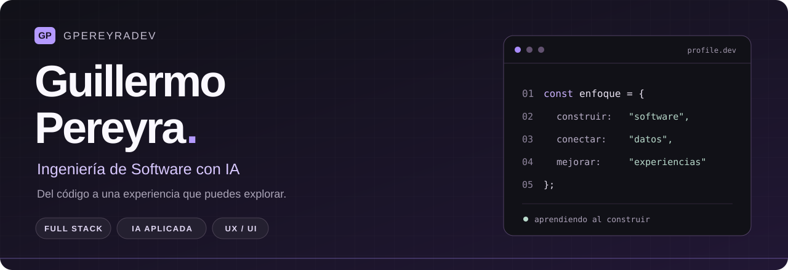

<!-- Perfil de Guillermo Pereyra. Las imágenes de proyectos se conservan en assets/. -->

  

  
  
  

# Hola, soy Guillermo 👋

Estudio **Ingeniería de Software con Inteligencia Artificial en SENATI**. Me gusta conectar lo que hay detrás de una aplicación —su lógica, sus datos y sus servicios— con una interfaz que se entienda y sea cómoda de usar.

Construyo proyectos de **desarrollo full stack, IA aplicada y aplicaciones Android**. También exploro el diseño UX/UI, los videojuegos y la creación visual en 2D y 3D. Aquí reúno lo que voy desarrollando, con código y demos para que puedas probarlo.

> **Aprender, construir, probar y mejorar.** Ese es el recorrido que busco reflejar en cada proyecto.

## Proyectos para explorar

<table>
<tr>
<td width="50%" valign="top">
<h3>NEXUS AI</h3>

<strong>Gestión empresarial + analítica.</strong> Ventas, inventario y clientes conectados con reportes y pronósticos. Un proyecto personal que integra frontend, backend, base de datos y aprendizaje automático.

<code>React</code> <code>TypeScript</code> <code>Java</code> <code>Spring Boot</code> <code>PostgreSQL</code> <code>Python</code>

<a href="https://github.com/gpereyradev/nexus-ai"><strong>Ver código ↗</strong></a> · <a href="https://nexus-ai-gpereyradev.onrender.com/">Abrir demo</a>

Datos ficticios. La demo requiere una cuenta habilitada.
</td>
<td width="50%" valign="top">
<h3>NeuroChess</h3>

<strong>Ajedrez contra un motor en Python.</strong> Minimax con poda alfa-beta, cuatro dificultades y métricas de búsqueda. Incluye pistas, historial, deshacer turnos y exportación de partidas.

<code>Python</code> <code>JavaScript</code> <code>HTML / CSS</code> <code>Minimax</code>

<a href="https://github.com/gpereyradev/neurochess-python"><strong>Ver código ↗</strong></a> · <a href="https://neurochess-python.onrender.com/">Jugar ahora</a>

Proyecto personal de inteligencia artificial clásica.
</td>
</tr>
<tr>
<td width="50%" valign="top">
<h3>Tuerka</h3>

<strong>Una web para encontrar vehículos.</strong> Catálogo con filtros, favoritos y fichas de detalle. Proyecto colaborativo que conecta un diseño en Figma con una experiencia web publicada.

<code>React</code> <code>JavaScript</code> <code>Supabase</code> <code>Figma</code>

<a href="https://github.com/Dgirto/ProyectoTuerka"><strong>Ver código ↗</strong></a> · <a href="https://proyecto-tuerka.vercel.app/">Visitar web</a>

Proyecto en equipo. Inventario de demostración.
</td>
<td width="50%" valign="top">
<h3>FitCoach</h3>

<strong>Entrenamiento y seguimiento del progreso.</strong> Participo en el backend con Laravel: perfiles, planes, registros y lógica de la aplicación, en coordinación con el equipo.

<code>PHP</code> <code>Laravel</code> <code>Backend</code> <code>Trabajo en equipo</code>

<a href="https://github.com/codainisoftware/fitcoach"><strong>Ver repositorio ↗</strong></a> · <a href="https://www.figma.com/design/U2EYU235ZzKVBzhKo8ZweA/FitCoach?node-id=812-1581">Ver diseño</a>

Producto en desarrollo. La imagen muestra el diseño en Figma.
</td>
</tr>
</table>

Las demos alojadas en Render pueden tardar en iniciar después de un período sin uso.

<a href="https://gpereyradev.github.io/PORTFOLIO-REACT/"><strong>Ver todos mis proyectos y sus casos en el portfolio →</strong></a>

## Tecnologías con las que construyo

**Frontend**

**Backend, datos e IA**

**Diseño y herramientas**

Además del desarrollo web, trabajo con **Java y SQLite en Android** y exploro **Godot, Arduino, redes y ciberseguridad defensiva**. En el portfolio puedes encontrar mis proyectos académicos, colaboraciones y credenciales.

## En qué estoy enfocado

- **Software completo:** conectar interfaces, APIs REST y bases de datos con reglas claras.
- **IA aplicada:** entender los algoritmos y mostrar qué hacen, desde Minimax hasta pronósticos con Python.
- **Experiencia de uso:** mejorar navegación, accesibilidad y presentación de cada proyecto.
- **Trabajo en equipo:** organizar módulos, documentar decisiones y colaborar con Git y GitHub.

## Conectemos

Me interesa colaborar en proyectos donde pueda aportar en desarrollo y seguir aprendiendo. Puedes revisar mis casos de proyecto, conocer mi perfil o escribirme:

**[Portfolio](https://gpereyradev.github.io/PORTFOLIO-REACT/)** · **[LinkedIn](https://www.linkedin.com/in/guillermo-anderson-pereyra-ramirez-403526343/)** · **[gpereyradev@gmail.com](mailto:gpereyradev@gmail.com)**

---

Guillermo Pereyra · gpereyradev Construyendo, una versión a la vez.

